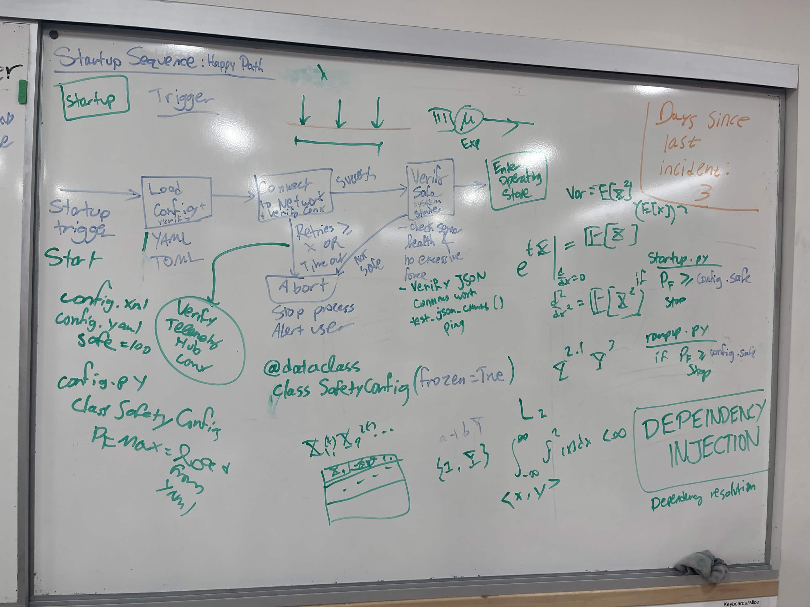

# Controls and Software for Soft Robotic Exoglove



## Repo layout

```
firmware/            ESP-IDF project (ESP32-S3), open this folder in VS Code
  main/              app_main and the state machine
    states/          startup, wait (ramp / hold / release to come)
    config/          pins.h, safety_config.h, app_config.h, secrets.h
  components/        pump, valve, pressure_sensor, comms (wifi + mqtt)
  test/              host unit tests for the state logic
hardware/            schematics, PCB, BOM, datasheets
mechanical/          CAD, molds, STLs
docs/                Doxyfile, diagrams and images
```

## Build and flash

1. Open the `firmware/` folder in VS Code with the ESP-IDF extension (IDF v6.1).
2. Copy `firmware/main/config/secrets.h.example` to `secrets.h` and fill in
   your WiFi and MQTT values. `secrets.h` is gitignored.
3. Build, flash and monitor from the extension, or in a terminal:

```bash
cd firmware
idf.py set-target esp32s3   # first time only
idf.py build flash monitor
```

`build/` and `managed_components/` are generated and not committed. The
component manager restores `managed_components/` from `dependencies.lock`.

## Tests

The state logic takes its hardware through function pointers (see
`WaitDeps` in `wait.h`), so it can be tested on a laptop:

```bash
cmake -S firmware/test -B firmware/test/build
cmake --build firmware/test/build
ctest --test-dir firmware/test/build --output-on-failure
```

## Docs

Install Doxygen, then generate the docs from the code comments:

```bash
sudo pacman -S doxygen graphviz     # or: sudo apt install doxygen graphviz
doxygen docs/Doxyfile
```

Open `docs/html/index.html`.

Document functions in the `.h` files like this:

```c
/**
 * @brief Run the startup sequence.
 * @return STARTUP_OK, or an ABORT_* code.
 */
```
